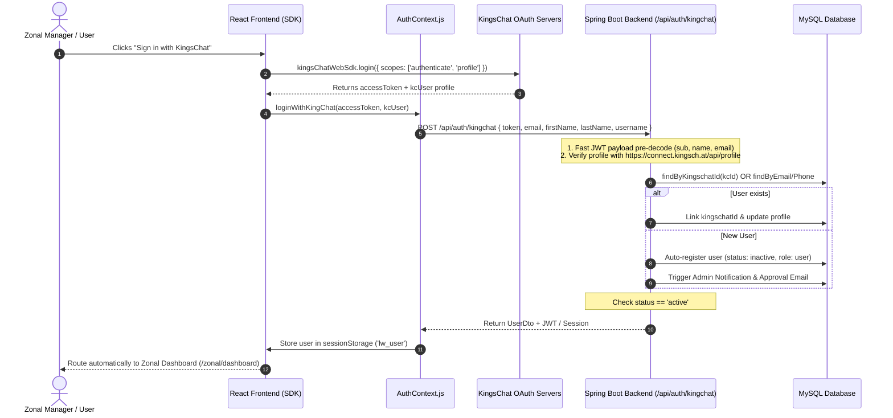

# 👑 KingsChat Authentication Integration
## Complete End-to-End Implementation Reference (Frontend & Backend)

This document contains the complete, production code implementation for the **KingsChat Single Sign-On (SSO) and Auto-Account Registration** system used in the Healing School Zonal Master Reporting Portal.

---

## 📌 Architecture Overview



---

## 💻 PART 1: FRONTEND IMPLEMENTATION (React)

### 1. Dependencies & Configuration
In `package.json`:
```json
{
  "dependencies": {
    "kingschat-web-sdk": "^0.1.0"
  }
}
```

Client ID configuration (configurable via `window.ENV` or `.env`):
```javascript
const KINGSCHAT_CLIENT_ID = (
  window.ENV?.KINGSCHAT_CLIENT_ID || 
  process.env.REACT_APP_KINGSCHAT_CLIENT_ID || 
  '5510380c-caac-4baa-ad0c-288dcdffaf1f'
).trim();
```

---

### 2. Sign In Component (`src/auth/Signin/signin.jsx`)

```javascript
import React, { useState, useEffect } from 'react';
import { useAuth } from '../AuthContext';
import { useToast } from '../../context/ToastContext';
import { useNavigate } from 'react-router-dom';
import kingsChatWebSdk from 'kingschat-web-sdk';
import 'kingschat-web-sdk/dist/stylesheets/style.min.css';
import '../Signup/styles.css';

export default function Signin({ onSwitch, onForgotPassword }) {
  const { user, loginWithKingChat } = useAuth();
  const { showToast } = useToast();
  const navigate = useNavigate();

  const [activeSection, setActiveSection] = useState(null);
  const [error, setError] = useState('');
  const [loading, setLoading] = useState(false);

  useEffect(() => {
    if (user) {
      navigate('/', { replace: true });
    }
  }, [user, navigate]);

  const handleKingChatLogin = () => {
    const loginOptions = {
      scopes: ["authenticate", "profile"],
      clientId: (window.ENV?.KINGSCHAT_CLIENT_ID || process.env.REACT_APP_KINGSCHAT_CLIENT_ID || '5510380c-caac-4baa-ad0c-288dcdffaf1f').trim(), 
    };
    
    setLoading(true);
    setError('');
    
    kingsChatWebSdk.login(loginOptions)
      .then(async (tokenResponse) => {
        console.log("KingsChat SDK Login Success:", tokenResponse);
        const { accessToken, user: kcUser } = tokenResponse;
        
        // Pass token and profile to AuthContext to authenticate with backend
        const err = await loginWithKingChat(accessToken, null, kcUser);
        setLoading(false);
        
        if (err) {
          console.error("Login Error from AuthContext:", err);
          setError(err);
        } else {
          showToast({
            icon: '✅',
            title: 'Welcome!',
            message: 'You have successfully logged in via KingsChat.',
          });
          
          setTimeout(() => {
            navigate('/', { replace: true });
          }, 100);
        }
      })
      .catch(err => {
        console.error("KingsChat login error:", err);
        setLoading(false);
        setError('KingsChat login was cancelled or failed.');
      });
  };

  const toggleSection = (section) => {
    if (loading) return;
    if (section === 'kingschat') {
      setActiveSection('kingschat');
      handleKingChatLogin();
      return;
    }
    setActiveSection(activeSection === section ? null : section);
  };

  return (
    <div className="auth-container">
      <div className="auth-card signup-card">
        <div className="signup-header">
          <h2 className="signup-main-title">Healing School</h2>
          <h3 className="signup-sub-title">Zonal Master Report</h3>
        </div>

        {error && (
          <div className="auth-error">
            <span>{error}</span>
          </div>
        )}

        <div className="signup-options">
          {/* KingsChat One-Click Button */}
          <button 
            className="signup-opt-btn kc-btn"
            onClick={() => toggleSection('kingschat')}
            disabled={loading}
          >
            <div className="opt-left">
              
              <span>{loading && activeSection === 'kingschat' ? 'CONNECTING...' : 'SIGN IN WITH KINGSCHAT'}</span>
            </div>
            <span className="opt-arrow">→</span>
          </button>
        </div>
      </div>
    </div>
  );
}
```

---

### 3. Sign Up Component (`src/auth/Signup/signup.jsx`)

```javascript
import kingsChatWebSdk from 'kingschat-web-sdk';
import 'kingschat-web-sdk/dist/stylesheets/style.min.css';

// Inside Signup component:
const handleKingChatLogin = () => {
  const loginOptions = {
    scopes: ["authenticate", "profile"],
    clientId: (window.ENV?.KINGSCHAT_CLIENT_ID || process.env.REACT_APP_KINGSCHAT_CLIENT_ID || '5510380c-caac-4baa-ad0c-288dcdffaf1f').trim(), 
  };
  
  kingsChatWebSdk.login(loginOptions)
    .then(async (tokenResponse) => {
      console.log("KingsChat SDK Signup/Login Success:", tokenResponse);
      const { accessToken, user: kcUser } = tokenResponse;
      const err = await loginWithKingChat(accessToken, null, kcUser);
      
      if (err) {
        if (err.toLowerCase().includes('created') || err.toLowerCase().includes('pending')) {
          setSuccess(true);
          setError('');
        } else {
          setError(err);
        }
      } else {
        setTimeout(() => {
          navigate('/', { replace: true });
        }, 100);
      }
    })
    .catch(err => {
      console.error("KingsChat login error:", err);
      setError('KingsChat login was cancelled or failed.');
    });
};
```

---

### 4. Authentication Context (`src/auth/AuthContext.js`)

```javascript
import React, { createContext, useContext, useState } from 'react';
import { flushPendingToasts } from '../context/NotificationContext';
import { getApiUrl } from '../utils/apiConfig';

const AuthContext = createContext(undefined);

const session = {
  get:    (key)        => { try { const r = sessionStorage.getItem(key); return r ? JSON.parse(r) : null; } catch { return null; } },
  set:    (key, value) => { try { sessionStorage.setItem(key, JSON.stringify(value)); } catch {} },
  remove: (key)        => { try { sessionStorage.removeItem(key); } catch {} },
};

export function AuthProvider({ children }) {
  const [user, setUser] = useState(() => session.get('lw_user') || null);

  const loginWithKingChat = async (accessToken, onPendingToasts, kcUser) => {
    const controller = new AbortController();
    const timeoutId = setTimeout(() => controller.abort(), 15000); // 15s timeout

    try {
      const apiUrl = getApiUrl();
      console.log(`[${new Date().toLocaleTimeString()}] AuthContext: Initiating KingsChat backend auth at ${apiUrl}`);
      
      const res = await fetch(`${apiUrl}/api/auth/kingchat`, {
        method: 'POST',
        headers: { 'Content-Type': 'application/json' },
        signal: controller.signal,
        body: JSON.stringify({
          token: accessToken,
          email: kcUser?.email || null,
          firstName: (kcUser?.first_name || kcUser?.firstName || (kcUser?.name ? kcUser.name.split(' ')[0] : null)),
          lastName: (kcUser?.last_name || kcUser?.lastName || (kcUser?.name && kcUser.name.includes(' ') ? kcUser.name.split(' ').slice(1).join(' ') : null)),
          username: kcUser?.username || null,
        })
      });

      clearTimeout(timeoutId);

      if (!res.ok) {
        const errText = await res.text();
        console.error("Backend Auth Error:", errText);
        return errText || `KingsChat login failed (${res.status}).`;
      }

      const userData = await res.json();
      console.log("KingsChat Login Success. UserData:", userData);

      // Verify active approval status
      if (userData.status && userData.status !== 'active') {
        session.remove('lw_user');
        setUser(null);
        return 'Your account is pending admin approval. Please contact an administrator.';
      }

      // Save user session
      session.set('lw_user', userData);
      setUser(userData);

      const pending = flushPendingToasts(userData.role);
      if (pending.length && onPendingToasts) onPendingToasts(pending, userData.role);

      return null;
    } catch (err) {
      clearTimeout(timeoutId);
      console.error("KingsChat Auth failed:", err);
      if (err.name === 'AbortError') {
        return 'Request timed out. The server is taking too long to respond.';
      }
      return 'Connection error: Could not reach the authentication server.';
    }
  };

  const logout = () => {
    session.remove('lw_user');
    setUser(null);
  };

  return (
    <AuthContext.Provider value={{ user, loginWithKingChat, logout }}>
      {children}
    </AuthContext.Provider>
  );
}

export function useAuth() {
  return useContext(AuthContext);
}
```

---

### 5. Role Routing Fallback (`src/router/RoleRouter.jsx`)
Ensures that KingsChat users who log in are automatically directed to the **Zonal Manager** layout:

```javascript
// Default fallback for KingsChat users (who get 'user' or unassigned by default)
// Maps them to the Zonal Manager Layout so they see the Zonal Portal automatically
return (
  <Routes>
    <Route path="/zonal" element={<ZonalMgrLayout />}>
      <Route index element={<Navigate to="dashboard" replace />} />
      <Route path="dashboard"     element={<ZonalDashboard />} />
      <Route path="reporting"     element={<ZonalReportingTabs />} />
      <Route path="analytics"     element={<ZonalAnalytics />} />
      <Route path="notifications" element={<Notifications />} />
      <Route path="settings"      element={<Settings />} />
      <Route path="submit-report" element={<SubmitReport />} />
      <Route path="zonal-info"    element={<ZonalInformationForm />} />
    </Route>
    <Route path="*" element={<Navigate to="/zonal/dashboard" replace />} />
  </Routes>
);
```

---

## ☕ PART 2: BACKEND IMPLEMENTATION (Spring Boot / Java)

### 1. REST Endpoint (`AuthController.java`)
```java
package com.reporting.portal.controller;

import com.reporting.portal.service.UserService;
import org.springframework.http.ResponseEntity;
import org.springframework.web.bind.annotation.*;
import java.util.Map;

@RestController
@RequestMapping("/api/auth")
public class AuthController {

    private final UserService userService;

    public AuthController(UserService userService) {
        this.userService = userService;
    }

    @PostMapping("/kingchat")
    public ResponseEntity<?> kingchatLogin(@RequestBody Map<String, String> request) {
        try {
            String token     = request.get("token");
            String email     = request.get("email");
            String firstName = request.get("firstName");
            String lastName  = request.get("lastName");
            String username  = request.get("username");
            
            return ResponseEntity.ok(
                userService.loginWithKingChatToken(token, email, firstName, lastName, username)
            );
        } catch (RuntimeException e) {
            return ResponseEntity.badRequest().body(e.getMessage());
        }
    }
}
```

---

### 2. Business Logic & Token Verification (`UserService.java`)

```java
package com.reporting.portal.service;

import com.reporting.portal.dto.UserDto;
import com.reporting.portal.entity.User;
import com.reporting.portal.repository.UserRepository;
import org.springframework.security.crypto.password.PasswordEncoder;
import org.springframework.stereotype.Service;

import java.net.URI;
import java.net.http.HttpClient;
import java.net.http.HttpRequest;
import java.net.http.HttpResponse;
import java.time.Duration;
import java.time.LocalTime;
import java.util.Base64;
import java.util.Map;
import java.util.UUID;
import com.fasterxml.jackson.databind.ObjectMapper;
import com.fasterxml.jackson.core.type.TypeReference;

@Service
public class UserService {

    private final UserRepository userRepository;
    private final AuditLogService auditLogService;
    private final EmailService emailService;
    private final NotificationService notificationService;
    private final PasswordEncoder passwordEncoder;
    private final HttpClient httpClient = HttpClient.newBuilder()
        .connectTimeout(Duration.ofSeconds(5))
        .build();

    public UserService(UserRepository userRepository, 
                       AuditLogService auditLogService, 
                       EmailService emailService, 
                       NotificationService notificationService,
                       PasswordEncoder passwordEncoder) {
        this.userRepository = userRepository;
        this.auditLogService = auditLogService;
        this.emailService = emailService;
        this.notificationService = notificationService;
        this.passwordEncoder = passwordEncoder;
    }

    public UserDto loginWithKingChatToken(String token, String email, String firstName, String lastName, String username) {
        if (token == null || token.isEmpty()) {
            throw new RuntimeException("Invalid KingsChat token");
        }
        
        String kcId = (username != null && !username.isEmpty()) ? username : null;
        String phone = null;
        
        // 0. Step 1: Pre-decode JWT payload to extract identity instantly
        try {
            String[] chunks = token.split("\\.");
            if (chunks.length >= 2) {
                Base64.Decoder decoder = Base64.getUrlDecoder();
                String payload = new String(decoder.decode(chunks[1]));
                ObjectMapper mapper = new ObjectMapper();
                Map<String, Object> claims = mapper.readValue(payload, new TypeReference<Map<String, Object>>() {});
                
                if (kcId == null && claims.containsKey("sub")) kcId = String.valueOf(claims.get("sub"));
                if (email == null && claims.containsKey("email")) email = String.valueOf(claims.get("email"));
                if (firstName == null && claims.containsKey("first_name")) firstName = String.valueOf(claims.get("first_name"));
                if (lastName == null && claims.containsKey("last_name")) lastName = String.valueOf(claims.get("last_name"));
                if (username == null && claims.containsKey("username")) username = String.valueOf(claims.get("username"));
                
                System.err.println("Pre-decoded JWT: sub=" + kcId + ", email=" + email);
            }
        } catch (Exception e) {
            System.err.println("Initial JWT decode failed: " + e.getMessage());
        }

        // 1. Step 2: Query KingsChat API Profile endpoint for live validation
        try {
            System.err.println("[" + LocalTime.now() + "] Verifying KingsChat profile...");
            HttpRequest profileReq = HttpRequest.newBuilder()
                .uri(URI.create("https://connect.kingsch.at/api/profile")) 
                .header("authorization", "Bearer " + token)
                .timeout(Duration.ofSeconds(3))
                .GET()
                .build();
            
            HttpResponse<String> response = httpClient.send(profileReq, HttpResponse.BodyHandlers.ofString());
            
            if (response.statusCode() == 200) {
                ObjectMapper mapper = new ObjectMapper();
                Map<String, Object> body = mapper.readValue(response.body(), new TypeReference<Map<String, Object>>() {});
                Map<String, Object> profileData = (Map<String, Object>) (body.getOrDefault("profile", body.getOrDefault("user", body)));

                if (profileData != null) {
                    if (profileData.containsKey("email")) {
                        Object emailObj = profileData.get("email");
                        email = (emailObj instanceof Map) ? String.valueOf(((Map)emailObj).getOrDefault("address", email)) : String.valueOf(emailObj);
                    }
                    if (profileData.containsKey("username")) username = String.valueOf(profileData.get("username"));
                    if (profileData.containsKey("id")) kcId = String.valueOf(profileData.get("id"));
                    if (profileData.containsKey("sub")) kcId = String.valueOf(profileData.get("sub"));
                    
                    if (profileData.containsKey("name")) {
                        String fullName = String.valueOf(profileData.get("name"));
                        String[] parts = fullName.trim().split(" ", 2);
                        firstName = parts[0];
                        if (parts.length > 1) lastName = parts[1];
                    }
                    if (profileData.containsKey("first_name") && profileData.get("first_name") != null) firstName = String.valueOf(profileData.get("first_name"));
                    if (profileData.containsKey("last_name") && profileData.get("last_name") != null) lastName = String.valueOf(profileData.get("last_name"));
                }
            }
        } catch (Exception e) {
            System.err.println("KingsChat API verification skipped/failed: " + e.getMessage());
        }

        if (kcId == null || kcId.isEmpty()) {
            throw new RuntimeException("Authentication Failed: KingsChat identity could not be verified.");
        }

        if (email == null || email.isEmpty()) {
            email = (username != null && !username.isEmpty()) ? username + "@kingschat.com" : kcId + "@kingschat.com";
        }
        
        if (firstName == null || firstName.trim().isEmpty()) {
            if (username != null && !username.trim().isEmpty()) {
                firstName = username;
                lastName = "";
            } else if (email != null && email.contains("@")) {
                firstName = email.substring(0, email.indexOf("@"));
                lastName = "";
            } else {
                firstName = "KingsChat";
                lastName = "User";
            }
        }
        
        if (lastName == null) lastName = "";
        
        return processKingChatUser(kcId, email, firstName, lastName, phone);
    }

    private UserDto processKingChatUser(String kcId, String email, String firstName, String lastName, String phone) {
        email = email.trim().toLowerCase();
        
        // 1. Check if user already exists by KingsChat ID
        var userByKcId = userRepository.findByKingschatId(kcId);
        
        User user;
        boolean needsSave = false;

        if (userByKcId.isPresent()) {
            user = userByKcId.get();
            // Update names if changed on KingsChat profile
            if (firstName != null && !firstName.equalsIgnoreCase("KingsChat") && !firstName.equals(user.getFirstName())) {
                user.setFirstName(firstName);
                needsSave = true;
            }
            if (lastName != null && !lastName.equalsIgnoreCase("User") && !lastName.equals(user.getLastName())) {
                user.setLastName(lastName);
                needsSave = true;
            }
        } else {
            // 2. Check if user already exists with matching email
            var userByEmail = userRepository.findByEmail(email);
            // 3. Check if user exists with matching phone
            var userByPhone = (phone != null) ? userRepository.findByPhone(phone) : java.util.Optional.<User>empty();

            if (userByEmail.isPresent()) {
                user = userByEmail.get();
                user.setKingschatId(kcId); // Auto-link KingsChat ID!
                needsSave = true;
            } else if (userByPhone.isPresent()) {
                user = userByPhone.get();
                user.setKingschatId(kcId); // Auto-link KingsChat ID!
                needsSave = true;
            } else {
                // 4. Create new account (Requires Admin Approval)
                user = new User();
                user.setEmail(email);
                user.setKingschatId(kcId);
                user.setFirstName(firstName);
                user.setLastName(lastName);
                user.setRole("user");
                user.setStatus("inactive"); // Inactive until Admin approves
                user.setPassword(passwordEncoder.encode(UUID.randomUUID().toString()));
                needsSave = true;
                
                // Notify Administrator
                try {
                    notificationService.push(new com.reporting.portal.dto.NotificationRequest(
                        "New KingsChat account registration pending approval: " + user.getEmail(), "admin", null
                    ));
                    emailService.sendAdminApprovalRequest(user.getEmail());
                    user.setAdminApprovalNotificationSent(true);
                } catch (Exception ignored) {}
            }
        }

        if (needsSave) {
            user = userRepository.save(user);
        }
        
        // 5. Enforce Admin approval check (Admins bypass approval)
        boolean isSystemAdmin = "admin".equalsIgnoreCase(user.getRole()) || 
                               "admin@loveworld.com".equalsIgnoreCase(user.getEmail()) || 
                               "sharonshelke1@gmail.com".equalsIgnoreCase(user.getEmail());

        if (!isSystemAdmin && !"active".equalsIgnoreCase(user.getStatus())) {
            System.err.println("KingsChat Login BLOCKED: Account pending admin approval for " + user.getEmail() + " (Status: " + user.getStatus() + ")");
            throw new RuntimeException("Your account is pending admin approval. Please contact an administrator.");
        }
        
        // 6. Increment login count
        user.setKingchatLoginCount((user.getKingchatLoginCount() != null ? user.getKingchatLoginCount() : 0) + 1);
        user = userRepository.save(user);
        
        try {
            auditLogService.logActivity(
                user.getFirstName() + " " + user.getLastName(), 
                user.getId(), 
                "Login", "Auth", "—", "Success", "Logged in via KingsChat."
            );
        } catch (Exception ignored) {}
        
        return mapToDto(user);
    }
}
```

---

### 3. JPA Entity & Repository

#### In `User.java`:
```java
@Column(name = "kingschat_id")
private String kingschatId;

@Column(name = "kingchat_login_count")
private Integer kingchatLoginCount = 0;

public String getKingschatId() { return kingschatId; }
public void setKingschatId(String kingschatId) { this.kingschatId = kingschatId; }

public Integer getKingchatLoginCount() { return kingchatLoginCount; }
public void setKingchatLoginCount(Integer kingchatLoginCount) { this.kingchatLoginCount = kingchatLoginCount; }
```

#### In `UserRepository.java`:
```java
package com.reporting.portal.repository;

import com.reporting.portal.entity.User;
import org.springframework.data.jpa.repository.JpaRepository;
import java.util.Optional;

public interface UserRepository extends JpaRepository<User, Long> {
    Optional<User> findByEmail(String email);
    Optional<User> findByPhone(String phone);
    Optional<User> findByKingschatId(String kingschatId);
    boolean existsByEmail(String email);
}
```

---

## 🔒 Summary of Key Features

1. **One-Click Instant Login:** Users authenticate with KingsChat Web SDK without entering or remembering any password.
2. **Auto Account Linking:** If a user registers with an email or phone and later logs in using KingsChat, the backend automatically links their `kingschatId` to the existing account.
3. **Resilient Two-Tier Token Verification:**
   - Pre-decodes token JWT payload (`sub`, `email`, name) for fast zero-latency response.
   - Cross-checks with the official `https://connect.kingsch.at/api/profile` endpoint with a 3-second timeout protection.
4. **Administrative Security Gate:** New KingsChat accounts default to status `inactive` and immediately notify administrators via email and in-app alerts for role assignment and activation.
